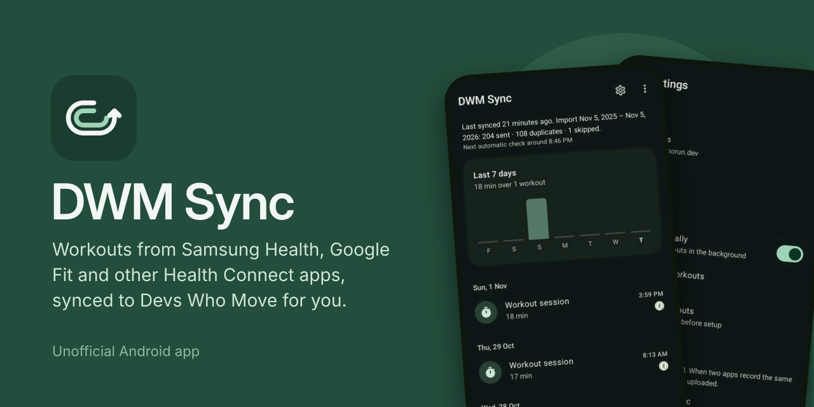
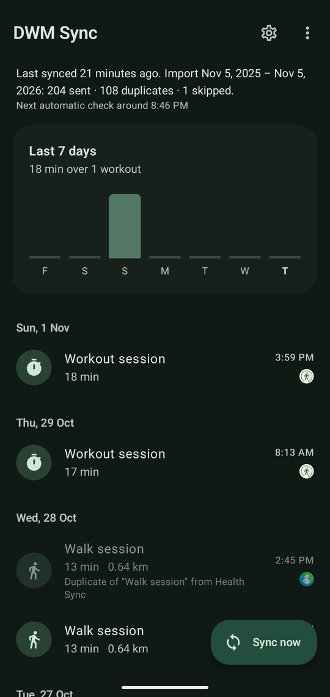
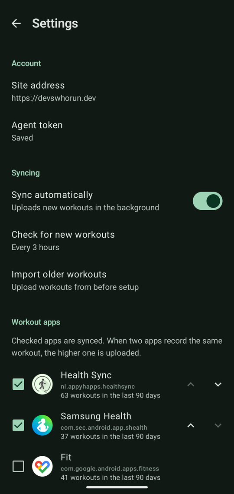
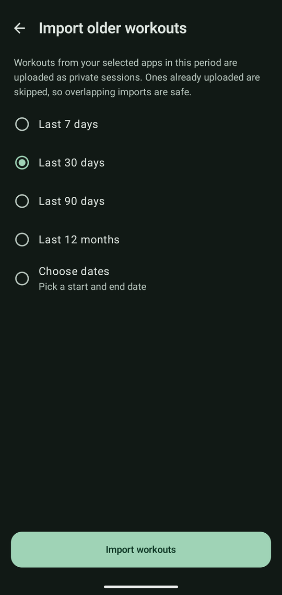

# DWM Sync

An Android app that uploads the workouts your fitness apps record (Samsung Health, Google Fit, Health Sync and any other app that writes to Health Connect) to your [Devs Who Move](https://devswhorun.dev) account, automatically and in the background.

**[Download the latest APK](https://github.com/yogeshpaliyal/dwm-sync/releases/download/latest/dwm-sync.apk)** · [Release notes](https://github.com/yogeshpaliyal/dwm-sync/releases/tag/latest)

> [!NOTE]
> This is an **unofficial**, community-built app. It isn't made, endorsed or supported by Devs Who Move. It uses the site's public agent API with a token you create yourself. For the official site, go to **[devswhorun.dev](https://devswhorun.dev)**.

## Screenshots

| Home | Settings | Import older workouts |
|:---:|:---:|:---:|
|  |  |  |

## Install
1. Download **[dwm-sync.apk](https://github.com/yogeshpaliyal/dwm-sync/releases/download/latest/dwm-sync.apk)** from the [Latest release](https://github.com/yogeshpaliyal/dwm-sync/releases/tag/latest). Every push to `main` rebuilds it as a release build shrunk with R8. You can also open this folder in Android Studio and run it from there.
2. Install the APK on your phone. You'll need to allow installs from your browser or file manager. New builds install over the old one, because every build is signed with the same `debug.keystore` from this repo.

## First-run setup (shown once)
1. **Welcome**: explains what the app does.
2. **Health Connect**: grant access to Exercise and Distance, plus background and past-data access if offered.
3. **Sources**: the app lists every app that has written workouts to Health Connect in the last 90 days, with its icon, workout count and devices. Tick the ones to sync and use the arrows to set priority. Samsung Health is ticked by default.
4. **Account**: enter the site URL and an agent token (`activities:write`, created under **Your agents** on [devswhorun.dev](https://devswhorun.dev)).
5. **Older workouts**: choose *Only new from now on*, the last 7, 30 or 90 days, the last 12 months, or **Pick dates…** for a custom range.

When you tap Finish, auto-sync is scheduled and the import you chose starts.

## Screens
- **Home**: a strip of bars for the last 7 days, one per day, sized by minutes moved. Below it is the workout log grouped by day. Duplicates and skipped workouts are dimmed with the reason, failures are shown in red, and tapping a workout shows its details. **Sync now** is the floating button. **Import older workouts** is in the ⋮ menu.
- **Settings**: a standard settings list covering the site address, agent token (with when it was saved and roughly when it expires), automatic sync and how often it checks, import, workout apps and their priority, Health Connect access, and clearing history or running setup again.
- **Setup**: five steps, one task each, with the main button at the bottom: welcome (shows the route your data takes), Health Connect, workout apps, account, and past workouts.

The app uses the Devs Who Move forest green (`#234D3C`) in both a light and a dark theme. Numbers use tabular figures so they line up.

## How it works
- Auto-sync is a periodic WorkManager job. It needs a network connection and backs off exponentially on errors.
- Each auto-sync reads `ExerciseSessionRecord` starting one day before the last synced session. It never looks earlier than the time setup finished, because older data comes in through imports. Distance is the sum of `DistanceRecord` over each session.
- Imports are a separate one-off job for the window you picked. They don't move the auto-sync position.
- **Duplicates**: two workouts count as the same if they have the same sport and overlap by at least half of the shorter one. If a matching workout from another app is already uploaded, or a higher-priority copy is in the same batch, the workout is marked *Duplicate of "…" from App* and not sent.
- The history is kept in `files/sync_log.json`, up to 2,000 entries. Workouts already marked Synced aren't sent again.
- The `Idempotency-Key` is `hc-<Health Connect record id>`, so retries and overlapping runs never create duplicates on the server.
- Responses are handled like this:
  - 2xx: marked Synced.
  - 409: marked Skipped (the workout changed after it was uploaded).
  - Other 4xx: marked Failed, with the error shown.
  - 401/403: the sync stops and asks for a new token.
  - Network errors, 429 and 5xx: retried later.
- The token is stored in EncryptedSharedPreferences, and backups are disabled.
- Release builds use R8 to shrink, optimise and obfuscate code, and drop unused resources, which also removes the unused extended Material icons. App-specific rules are in `app/proguard-rules.pro`. Each release includes `dwm-sync-mapping.txt` for turning crash traces back into readable ones. Debug builds aren't shrunk.

## Sport mapping
| Health Connect | Devs Who Move |
|---|---|
| Running, Treadmill | Running |
| Biking, Stationary bike | Cycling |
| Tennis | Tennis |
| Walking | Walking |
| Pool / Open-water swim | Swimming |
| Strength training, Weightlifting | Strength |
| Everything else (hike, yoga, badminton, cricket…) | Other, with the type kept in the notes |

## Notes
- Samsung Health only writes to Health Connect when Samsung Health itself syncs. Opening it now and then keeps the data fresh.
- Device names come from each app's Health Connect metadata. Many apps leave them blank, so only the app name is shown.
- Without past-data access, Health Connect only shares about the last 30 days, so older imports come back empty.
- If the status says "blocked the read", your Health Connect version doesn't allow background reads. Tap **Sync now** while the app is open.
